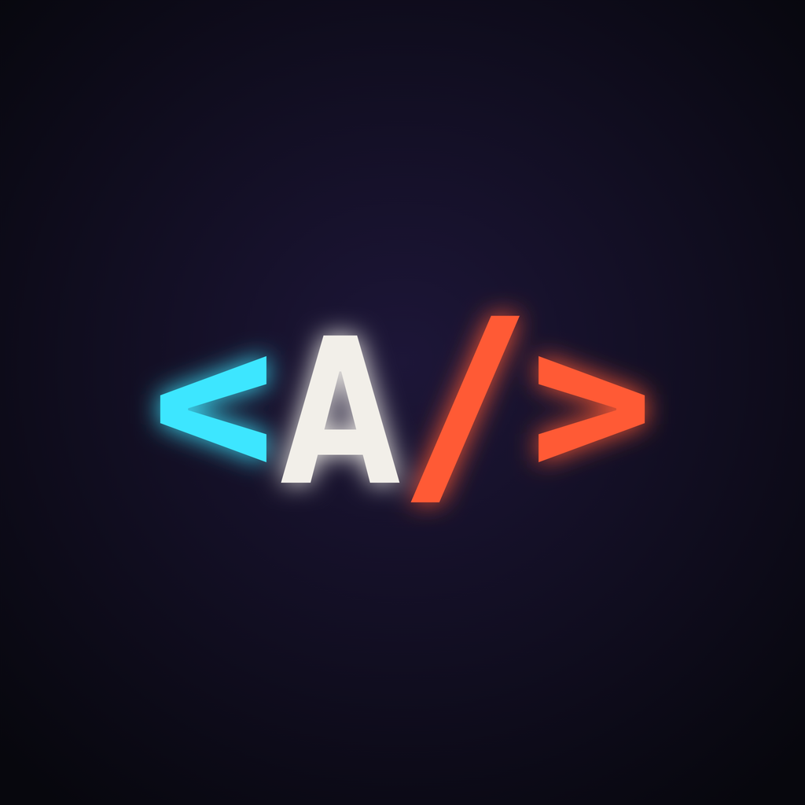
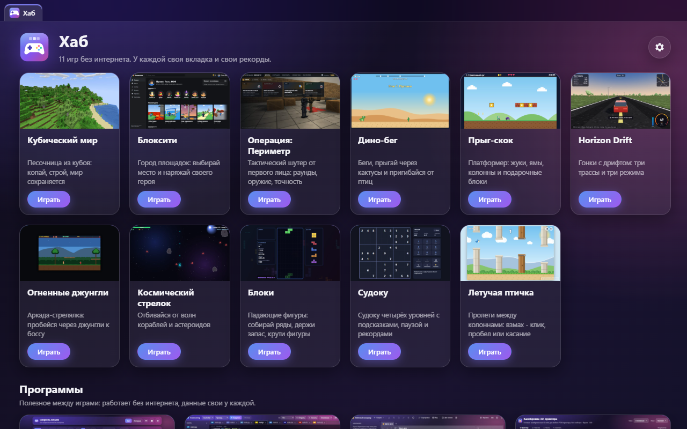

# Alex

**Windows desktop apps, small neural networks and the tests that keep them honest.**

Most of what is here I use myself: a paint program, a local AI workbench, a translator that runs without the internet, a downloads sorter, a folder sync. Projects with a release have a build you can download and run; the rest are marked as work in progress or planned.

Интерфейсы программ на русском, README у каждого проекта на английском и русском.

Code, tests and docs are written by Claude (Anthropic) in Claude Code. Ideas, testing and decisions - Alexey.

## Projects

<table>
<tr>
<td width="50%" valign="top">

 <b><a href="https://github.com/ALEXalesha/PaintPro">Paint Pro</a></b> · Electron + C#/WPF
 A raster editor written twice: one HTML file in Electron that also <a href="https://alexalesha.github.io/PaintPro/">runs in the browser</a>, and a native C# twin on SkiaSharp. Layers, a history where any edit can be switched off.
</td>
<td width="50%" valign="top">

 <b><a href="https://github.com/ALEXalesha/AiWorkbench">AlexGPT</a></b> · Python, PyTorch, Qt
 A local AI workbench: chat through LM Studio, plus models trained from scratch (translator, named entities, sentiment, spam) and a canvas that reads what you draw.
</td>
</tr>
<tr>
<td width="50%" valign="top">

 <b><a href="https://github.com/ALEXalesha/HorizonDrift">Horizon Drift</a></b> · JavaScript, three.js
 An arcade racing and drifting game in 3D, in one HTML page: a career, eight cars, free roam, AI rivals and car damage. Models, sound and music are made by code. <a href="https://alexalesha.github.io/HorizonDrift/">Play online</a>.
</td>
<td width="50%" valign="top">

 <b><a href="https://github.com/ALEXalesha/LiquidGlass">Liquid Glass</a></b> · HTML, SVG filters, WebGL2
 The iOS 26 glass rebuilt on the web twice, with refraction, dispersion and live controls. <a href="https://alexalesha.github.io/LiquidGlass/">Open the demo</a>.
</td>
</tr>
<tr>
<td width="50%" valign="top">

 <b><a href="https://github.com/ALEXalesha/AiBoy">AiBoy</a></b> · NumPy + Qt (PySide6)
 A living aquarium run by neural networks: one invents a 2D world, another a little person, and he learns on his own to walk, swim, play the guitar, tame a dog and climb mountains.
</td>
<td width="50%" valign="top">

 <b><a href="https://github.com/ALEXalesha/ALEXalesha.github.io">Hub</a></b> · HTML, Electron
 Everything web I made in one place: eleven games, five programs (a compiler, a media player, a file manager...) and four system demos, each in its own tab, offline. <a href="https://alexalesha.github.io/">Open it</a> - it is this site's home page - or install the Windows app.
</td>
</tr>
</table>

| Tool | What it does | Stack |
| --- | --- | --- |
| [SyncGlass](https://github.com/ALEXalesha/SyncGlass) | Folder sync between a laptop and a PC on the network: preview first, moves recognised, and Stop undoes the whole run | Electron, C# |
| [CalculatorPro](https://github.com/ALEXalesha/CalculatorPro) | Three Liquid Glass calculators with their own parsers and no `eval`; the WPF one counts in `decimal`, so 0.1 + 0.2 is exactly 0.3 | C#/WPF, Electron |
| [SaltTranslator](https://github.com/ALEXalesha/SaltTranslator) | Offline translator on NLLB-3.3B, on the CPU: 202 languages plus the languages of Uganda | Python, CTranslate2, Electron |
| [IntelligenceDrawer](https://github.com/ALEXalesha/IntelligenceDrawer) | Draw with the mouse, a CNN reads digits, letters and maths signs, left to right, as numbers or words | PyTorch, tkinter |
| [InstallerModels](https://github.com/ALEXalesha/InstallerModels) | Downloads ComfyUI models back from Hugging Face: resumable, size- and sha256-checked, your own models by link | Python, Qt |
| [SortDownloads](https://github.com/ALEXalesha/SortDownloads) | Sorts the Downloads folder by category and type: plan first, undo always, rules editable from the window | PyQt6 |
| [WheelScript](https://github.com/ALEXalesha/WheelScript) | A racing wheel as mouse, keyboard or a virtual Xbox gamepad, for games that do not understand a wheel | Python, Qt |
| [Checklist](https://github.com/ALEXalesha/Checklist) | A checklist with a note on every item; each list is a plain JSON file | Python, Qt |
| [TimetableToPdf](https://github.com/ALEXalesha/TimetableToPdf) | Turns a landscape A4 school timetable (.docx or .pdf) into a half-sheet PDF ready to print and cut | Python, Qt |
| [WritingSpeed](https://github.com/ALEXalesha/WritingSpeed) | A typing speed test: time, words, texts, zen; six languages and code; WPM, accuracy, mistakes by key on the keyboard. [Try it online](https://alexalesha.github.io/WritingSpeed/) | HTML, Electron |
| [Calibrate3dPrinter](https://github.com/ALEXalesha/Calibrate3dPrinter) | Ready calibration G-code for any FDM printer, no slicer: ten tests, set up from a G-code you already printed. The same bytes from two editions; [open in the browser](https://alexalesha.github.io/Calibrate3dPrinter/) | JavaScript, Electron, Python, Qt |
| [MediaPlayer](https://github.com/ALEXalesha/MediaPlayer) | A music and video player in one page with its own album: 12 songs written by a song generator and played through Web Audio; your files, playlist, 10-band equalizer, visualizer, media keys. [Try it online](https://alexalesha.github.io/MediaPlayer/) | HTML, Web Audio, Electron |
| [FilesManager](https://github.com/ALEXalesha/FilesManager) | A file explorer in one page: folder tree, tabs, two panels, wildcard search, preview, Windows Explorer hotkeys. The Windows app deletes only to the Recycle Bin, even with Shift+Del. [Try it online](https://alexalesha.github.io/FilesManager/) (demo disk) | HTML, Electron |
| [Slicer](https://github.com/ALEXalesha/Slicer) | Slicer CC, a simple slicer for the Elegoo Centauri Carbon: three choices for beginners, every setting in Advanced, and sending that checks the printer really got the file. Not released yet | Electron |
| [AiFor3DPrinter](https://github.com/ALEXalesha/AiFor3DPrinter) | A neural network watches the printer camera while it prints and sends a Telegram alert with a heat map on spaghetti, a detached part or a nozzle blob | Python, ONNX |

## Games and web demos

Everything here runs in the browser, offline once loaded, with tests in headless Chromium.

| Project | What it is | Play |
| --- | --- | --- |
| [Hub](https://github.com/ALEXalesha/ALEXalesha.github.io) | The Hub (formerly Igroteka): eleven games, five programs and four system demos in tabs of one page, also a Windows app | [open](https://alexalesha.github.io/) |
| [RailRunner](https://github.com/ALEXalesha/RailRunner) | An endless 3D runner on three railway tracks: hurdles, bars, oncoming trains, coins and power-ups, also a Windows app | [open](https://alexalesha.github.io/RailRunner/) |
| [Compiler](https://github.com/ALEXalesha/Compiler) | C, C++, Python, JavaScript, TypeScript, Lua, Ruby and SQL in the browser: Clang compiles C/C++ to WebAssembly, every program in its own worker with a time limit, errors on their line | [open](https://alexalesha.github.io/Compiler/) |
| [HorizonDrift](https://github.com/ALEXalesha/HorizonDrift) | A 3D drift racer with AI rivals and a level editor | [open](https://alexalesha.github.io/HorizonDrift/) |
| [AlexMine](https://github.com/ALEXalesha/AlexMine) | A voxel sandbox: endless world, caves, water, day and night | [open](https://alexalesha.github.io/AlexMine/) |
| [BlockCity](https://github.com/ALEXalesha/BlockCity) | A small place-based block platform: worlds, avatars, an editor | [open](https://alexalesha.github.io/BlockCity/) |
| [OperationPerimeter](https://github.com/ALEXalesha/OperationPerimeter) | A tactical shooter against bots on a defuse map | [open](https://alexalesha.github.io/OperationPerimeter/) |
| [WindowsDemo](https://github.com/ALEXalesha/WindowsDemo) · [MacOSDemo](https://github.com/ALEXalesha/MacOSDemo) · [iOSDemo](https://github.com/ALEXalesha/iOSDemo) · [AndroidDemo](https://github.com/ALEXalesha/AndroidDemo) | Fan-made desktop and phone shells with working apps and the games inside | [Win](https://alexalesha.github.io/WindowsDemo/) · [Mac](https://alexalesha.github.io/MacOSDemo/) · [iOS](https://alexalesha.github.io/iOSDemo/) · [Android](https://alexalesha.github.io/AndroidDemo/) |
| [DinoRun](https://github.com/ALEXalesha/DinoRun) · [JumpJump](https://github.com/ALEXalesha/JumpJump) · [HotJungle](https://github.com/ALEXalesha/HotJungle) · [SpaceGun](https://github.com/ALEXalesha/SpaceGun) · [FallingBlocks](https://github.com/ALEXalesha/FallingBlocks) · [SudokuGame](https://github.com/ALEXalesha/SudokuGame) · [FlappyWings](https://github.com/ALEXalesha/FlappyWings) | Small arcade and puzzle games, one HTML file each | [Dino](https://alexalesha.github.io/DinoRun/) · [Jump](https://alexalesha.github.io/JumpJump/) · [Jungle](https://alexalesha.github.io/HotJungle/) · [Space](https://alexalesha.github.io/SpaceGun/) · [Blocks](https://alexalesha.github.io/FallingBlocks/) · [Sudoku](https://alexalesha.github.io/SudokuGame/) · [Wings](https://alexalesha.github.io/FlappyWings/) |

## Games that learn

Windows games against an AI that taught itself, PySide6 and numpy. Most of them also open as tabs of [AiGameRoom](https://github.com/ALEXalesha/AiGameRoom).

| Game | What the AI does | State |
| --- | --- | --- |
| [SnakeAi](https://github.com/ALEXalesha/SnakeAi) | One network designs the window, another draws the cells, the snake learns to play | release |
| [TicTacToeAi](https://github.com/ALEXalesha/TicTacToeAi) | Tic-tac-toe on several board sizes | release |
| [AiCar](https://github.com/ALEXalesha/AiCar) | A car that learns to drive a track | release |
| [AiBoy](https://github.com/ALEXalesha/AiBoy) | See above: a little person that learns to live in a generated world | release |
| [DurakAi](https://github.com/ALEXalesha/DurakAi) | Durak against an AI that never peeks | release |
| [RockPaperAi](https://github.com/ALEXalesha/RockPaperAi) | Learns your habits; its move is sealed before you choose | release |
| [BlockDropAi](https://github.com/ALEXalesha/BlockDropAi) | Falling blocks: play, watch the AI or duel it | release |
| [SaperAi](https://github.com/ALEXalesha/SaperAi) | Minesweeper with the exact chance of a mine in every closed cell | release |
| [SeaWarAi](https://github.com/ALEXalesha/SeaWarAi) | Battleship against an AI that never sees your board | release |
| [2048Ai](https://github.com/ALEXalesha/2048Ai) | n-tuple network, TD learning, expectimax | in progress |
| [ChessCheckersAi](https://github.com/ALEXalesha/ChessCheckersAi) | Checkers and chess, learned by self-play | in progress |
| [LabirinthAi](https://github.com/ALEXalesha/LabirinthAi) | Solves mazes in the fog it has never seen | in progress |
| [MiniRTSAi](https://github.com/ALEXalesha/MiniRTSAi) | Real-time strategy against an AI limited by the fog of war | in progress |
| [PingPongAirHockeyAi](https://github.com/ALEXalesha/PingPongAirHockeyAi) | Ping-pong and air hockey on its own 2D physics | in progress |
| [RubiksCubeAi](https://github.com/ALEXalesha/RubiksCubeAi) | A 3D cube 2x2 to 4x4: solve it, learn it, or let the AI solve it | in progress |
| [TanksAi](https://github.com/ALEXalesha/TanksAi) | Top-down tanks that see only their line of sight | in progress |
| [TennisAi](https://github.com/ALEXalesha/TennisAi) | Tennis in a tilted retro view, singles and doubles | in progress |

## Mods

- [ETS2Mods](https://github.com/ALEXalesha/ETS2Mods) and [AmericanTruckSimulatorMods](https://github.com/ALEXalesha/AmericanTruckSimulatorMods): single-player mods for Euro Truck Simulator 2 and American Truck Simulator, built from the games' own files, also on the Steam Workshop.
- [MudRunnerMods](https://github.com/ALEXalesha/MudRunnerMods): OpenTrail, gameplay mods for Spintires: MudRunner and the tools that build and check them.
- [TeardownMods](https://github.com/ALEXalesha/TeardownMods): 17 mods for Teardown 2.x - catapult, earthquake, tsunami, tornado, camera drone and more.
- [MyCS2Map](https://github.com/ALEXalesha/MyCS2Map): a Counter-Strike 2 map, de_Hum.
- [GarrysModMods](https://github.com/ALEXalesha/GarrysModMods): Garry's Mod addons, planned.

## Other and planned

- [VideosAndMusicInCode](https://github.com/ALEXalesha/VideosAndMusicInCode): videos and music made entirely in code - showreels, a crab story, pieces with notes on screen.
- [My3dModels](https://github.com/ALEXalesha/My3dModels): 3D-printable models made in Blender, with sources and print settings.
- Planned, no code yet or just started: [PcInfo](https://github.com/ALEXalesha/PcInfo) (PC hardware, temperatures and ports, C#/WPF), [FormatBox](https://github.com/ALEXalesha/FormatBox) (a converter for video, audio, images, documents and 3D), [ProjectScore](https://github.com/ALEXalesha/ProjectScore) (a page that scores these projects), [TearDown](https://github.com/ALEXalesha/TearDown) (a voxel world in the browser where everything breaks), [GoingBoy](https://github.com/ALEXalesha/GoingBoy) (human movement with joints and muscles), [InternetBrowser](https://github.com/ALEXalesha/InternetBrowser) (a browser on Electron).

## How these are made

- **Tests state laws, not examples.** Most suites generate thousands of random inputs (hypothesis, fast-check, FsCheck) and check invariants after every step: a parsed expression prints back to the same tree, undoing everything returns the starting state, a download never leaves a wrong file under the real name. That is where most of the bugs in these repositories were found.
- **Screenshots are drawn by programs, never taken from the screen.** Each project has a script that opens the real app, clicks through it and renders the window itself. The screenshots keep catching bugs too: a white icon in a light theme, `*` where the button says `×`, a transparent frame around a window.
- **Every release is a real build you can run**, a portable one and an installer, with notes that say what was wrong and why, not just what changed.
